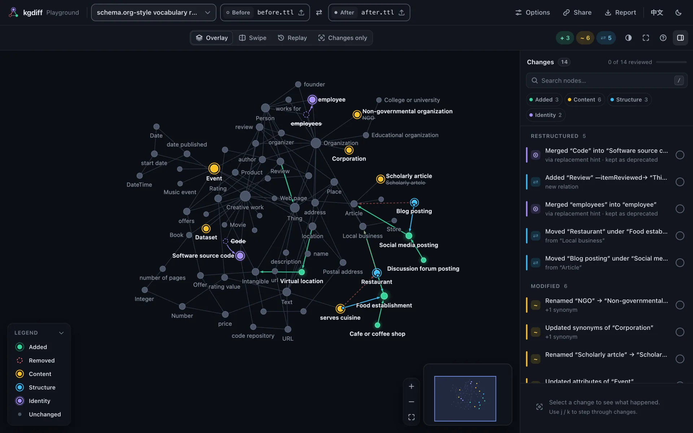

# Embed the viewer

`<kgdiff-viewer>` is a web component: one custom element that works with any framework, or none.
It is the same viewer as in the HTML reports and the playground.



## Install

```sh
npm install @kgdiff/viewer
```

The package is ESM only and runs in evergreen browsers.

## Show a diff

```html
<kgdiff-viewer theme="auto" style="height: 640px"></kgdiff-viewer>

<script type="module">
  import '@kgdiff/viewer'; // defines <kgdiff-viewer>

  const viewer = document.querySelector('kgdiff-viewer');
  const text = async (url) => (await fetch(url)).text();
  await viewer.load({
    before: { text: await text('/graphs/v1.ttl'), filename: 'v1.ttl' },
    after: { text: await text('/graphs/v2.ttl'), filename: 'v2.ttl' },
  });
</script>
```

Give the element a height. `load()` takes each side as one of:

- `{ text, filename }`: parsed with `@kgdiff/formats`, the format detected from the file name and
  the content; `parse` passes parser options;
- a graph object `{ nodes, edges }` in [kgdiff JSON](../formats.md#kgdiff-json);
- a normalized graph from `@kgdiff/core`.

Optionally, `diff` passes [diff options](./library.md#options) (matching, hierarchy predicates,
ignored attributes), `names` the names of the two sides and `title` a title. The parsers, the
diff engine and the layout are loaded on demand, so they stay out of your initial bundle.

## Listen and control

```js
viewer.addEventListener('kgdiff-ready', (event) => console.log(event.detail.stats));
viewer.addEventListener('kgdiff-select', (event) => console.log(event.detail.hunk));

viewer.next(); // select the next change
viewer.mode = 'replay';
viewer.play();
```

| Attribute          | Values                                                        | Default                    |
| ------------------ | ------------------------------------------------------------- | -------------------------- |
| `mode`             | `overlay`, `swipe`, `replay` (legacy `changes`, see below)    | `overlay`                  |
| `scope`            | `all`, `changes`: only the changes, in any mode               | `all` (`changes` if large) |
| `theme`            | `auto`, `light`, `dark`                                       | `auto`                     |
| `palette`          | `default`, `colorblind`                                       | `default`                  |
| `locale`           | `en`, `zh-CN`                                                 | from `navigator.language`  |
| `sidebar`          | `open`, `closed`                                              |                            |
| `sync-hash`        | boolean: deep links `#kgdiff=hunk:<id>;mode:<m>;scope:<s>`    |                            |
| `global-shortcuts` | boolean: shortcuts work when nothing on the page has focus    |                            |
| `header`           | `compact`: no brand or graph names, when your page shows them |                            |
| `chrome`           | `none`: the graph alone, for small embeds                     | `full`                     |
| `legend`           | `auto`, `full`, `mini` (one line), `none`                     | `auto`                     |
| `loop`             | boolean: the replay plays by itself, over and over            |                            |
| `loop-delay`       | ms between the end of a looping replay and its restart        | `1200`                     |
| `pause-on-hover`   | `false`: a looping replay keeps playing under the mouse       | pauses                     |

`mode="changes"`, from before scopes existed, still works: it means `overlay` with
`scope="changes"`, and the attributes are rewritten to say so.

`mode`, `scope`, `theme`, `palette`, `locale`, `chrome`, `legend`, `loop`, `loopDelay` and
`pauseOnHover` are also properties. Methods: `load()`, `selectHunk(id)`, `next()`, `prev()`,
`play()`, `pause()`, `fit({ animate, padding })`, `exportDelta()`, `reviewState()` and
`setReviewed(id, reviewed)`. Events, all bubbling and composed: `kgdiff-ready` `{ stats }`,
`kgdiff-select` `{ hunk, node }`, `kgdiff-mode` `{ mode, scope }`, `kgdiff-review`
`{ hunk, reviewed, progress }`, `kgdiff-error` `{ error }` and `kgdiff-replay-end` `{ loop }`.
[Viewer: interaction and API](../interaction.md#embedding-api) has the details.

## Embed a small looping replay

To show a graph's changes as a small strip on another page, leave the review UI out and let the
replay loop:

```html
<kgdiff-viewer mode="replay" chrome="none" loop style="height: 320px"></kgdiff-viewer>
```

`chrome="none"` keeps the graph, its hover tooltip and a one-line legend; the header, change
list, step caption, playback bar, zoom buttons and minimap go, clicks and shortcuts do nothing
and the view stays fitted, labels included: no name is cut at the edge. `loop` replays the changes, pausing
`loop-delay` ms (1.2 s) between rounds and while the mouse is over the graph.
`kgdiff-replay-end` fires at the end of every round.

## Keep review progress

The viewer remembers in the browser which changes were marked reviewed. To keep that progress
somewhere else, such as your backend, listen to `kgdiff-review` and restore it with
`setReviewed()`:

```js
viewer.addEventListener('kgdiff-review', (event) => save(event.detail.progress.reviewed));
viewer.addEventListener('kgdiff-ready', async () => {
  for (const id of await loadSaved()) viewer.setReviewed(id, true);
});
```

## React

Use a ref to call `load()` and to listen to events:

```jsx
import '@kgdiff/viewer';
import { useEffect, useRef } from 'react';

export function GraphDiff({ before, after, onSelect }) {
  const viewer = useRef(null);

  useEffect(() => {
    viewer.current.load({ before, after });
  }, [before, after]);

  useEffect(() => {
    const element = viewer.current;
    const listener = (event) => onSelect(event.detail.hunk);
    element.addEventListener('kgdiff-select', listener);
    return () => element.removeEventListener('kgdiff-select', listener);
  }, [onSelect]);

  return <kgdiff-viewer ref={viewer} theme="auto" style={{ height: 640 }} />;
}
```

In TypeScript, declare `kgdiff-viewer` in `JSX.IntrinsicElements`; the package exports the
element's type as `KgdiffViewerElement`.

## Vue

Tell Vue that `kgdiff-*` tags are custom elements, in `vite.config.js`:

```js
import vue from '@vitejs/plugin-vue';

export default {
  plugins: [
    vue({ template: { compilerOptions: { isCustomElement: (tag) => tag.startsWith('kgdiff-') } } }),
  ],
};
```

then use it like any element:

```vue
<script setup>
import '@kgdiff/viewer';
import { onMounted, ref } from 'vue';

const props = defineProps(['before', 'after']);
const emit = defineEmits(['select']);
const viewer = ref(null);

onMounted(() => viewer.value.load({ before: props.before, after: props.after }));
const onSelect = (event) => emit('select', event.detail.hunk);
</script>

<template>
  <kgdiff-viewer ref="viewer" theme="auto" style="height: 640px" @kgdiff-select="onSelect" />
</template>
```

## Without a bundler

`@kgdiff/viewer/standalone` (`dist/standalone/kgdiff-viewer.js`) is a classic script that defines
the element and shows precomputed diffs: it is what the HTML reports of the CLI embed. With its
compute add-on, `@kgdiff/viewer/standalone/compute` (`kgdiff-viewer-compute.js`), it can also
`load()` graph objects (`{ nodes, edges }`). Parsing text in the browser needs the ESM package
and a bundler.

## Large graphs

For large graphs the viewer opens with Changes only on, which lays out the changes and their
neighbourhood instead of the whole graph. Computing a big diff and its layout takes time in the
browser; the CLI's HTML report does that work ahead of time and opens instantly.
