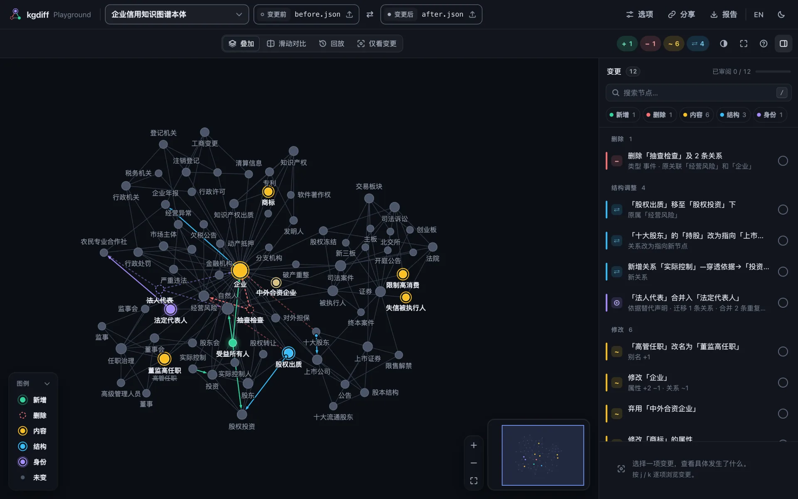

# 嵌入查看器

`<kgdiff-viewer>` 是一个 Web 组件：一个自定义元素，可以配合任何框架使用，也可以不用框架。它和 HTML 报告、Playground 里的查看器是同一个。



## 安装

```sh
npm install @kgdiff/viewer
```

这个包只提供 ESM，可在主流现代浏览器中运行。

## 显示一份 diff

```html
<kgdiff-viewer theme="auto" style="height: 640px"></kgdiff-viewer>

<script type="module">
  import '@kgdiff/viewer'; // 定义 <kgdiff-viewer>

  const viewer = document.querySelector('kgdiff-viewer');
  const text = async (url) => (await fetch(url)).text();
  await viewer.load({
    before: { text: await text('/graphs/v1.ttl'), filename: 'v1.ttl' },
    after: { text: await text('/graphs/v2.ttl'), filename: 'v2.ttl' },
  });
</script>
```

记得给元素设置高度。`load()` 的每一侧可以是：

- `{ text, filename }`：用 `@kgdiff/formats` 解析，格式根据文件名和内容判断；`parse` 用来传解析选项；
- [kgdiff JSON](../formats.md#kgdiff-json) 形式的图对象 `{ nodes, edges }`；
- `@kgdiff/core` 规范化后的图。

另外还可以传 `diff`，即 [diff 选项](./library.md#选项)（匹配方式、层级谓词、忽略的属性），传 `names` 给两侧命名，传 `title` 设置标题。解析器、diff 引擎和布局都是按需加载的，不会进入你的首屏包。

## 监听与控制

```js
viewer.addEventListener('kgdiff-ready', (event) => console.log(event.detail.stats));
viewer.addEventListener('kgdiff-select', (event) => console.log(event.detail.hunk));

viewer.next(); // 选中下一个变化
viewer.mode = 'replay';
viewer.play();
```

| 属性               | 取值                                                    | 默认                          |
| ------------------ | ------------------------------------------------------- | ----------------------------- |
| `mode`             | `overlay`、`swipe`、`replay`、`changes`                 | `overlay`（大图为 `changes`） |
| `theme`            | `auto`、`light`、`dark`                                 | `auto`                        |
| `palette`          | `default`、`colorblind`                                 | `default`                     |
| `locale`           | `en`、`zh-CN`                                           | 取自 `navigator.language`     |
| `sidebar`          | `open`、`closed`                                        |                               |
| `sync-hash`        | 布尔值：深链接 `#kgdiff=hunk:<id>;mode:<mode>`          |                               |
| `global-shortcuts` | 布尔值：页面上没有焦点时快捷键也生效                    |                               |
| `header`           | `compact`：不显示品牌和图名，适合页面自己显示这些信息时 |                               |

`mode`、`theme`、`palette` 和 `locale` 同时也是 JavaScript 属性。方法：`load()`、`selectHunk(id)`、`next()`、`prev()`、`play()`、`pause()`、`fit()`、`exportDelta()`、`reviewState()` 和 `setReviewed(id, reviewed)`。事件都会冒泡并穿过 Shadow DOM：`kgdiff-ready` `{ stats }`、`kgdiff-select` `{ hunk, node }`、`kgdiff-mode` `{ mode }`、`kgdiff-review` `{ hunk, reviewed, progress }` 和 `kgdiff-error` `{ error }`。详见[查看器：交互与 API](../interaction.md#嵌入-api)。

## 保存审阅进度

查看器会在浏览器里记住哪些变化已标记为已审阅。要把进度存到别处，比如你的后端，可以监听 `kgdiff-review`，再用 `setReviewed()` 恢复：

```js
viewer.addEventListener('kgdiff-review', (event) => save(event.detail.progress.reviewed));
viewer.addEventListener('kgdiff-ready', async () => {
  for (const id of await loadSaved()) viewer.setReviewed(id, true);
});
```

## React

用 ref 调用 `load()` 并监听事件：

```jsx
import '@kgdiff/viewer';
import { useEffect, useRef } from 'react';

export function GraphDiff({ before, after, onSelect }) {
  const viewer = useRef(null);

  useEffect(() => {
    viewer.current.load({ before, after });
  }, [before, after]);

  useEffect(() => {
    const element = viewer.current;
    const listener = (event) => onSelect(event.detail.hunk);
    element.addEventListener('kgdiff-select', listener);
    return () => element.removeEventListener('kgdiff-select', listener);
  }, [onSelect]);

  return <kgdiff-viewer ref={viewer} theme="auto" style={{ height: 640 }} />;
}
```

在 TypeScript 中，需要在 `JSX.IntrinsicElements` 里声明 `kgdiff-viewer`；包里导出了这个元素的类型 `KgdiffViewerElement`。

## Vue

先在 `vite.config.js` 里告诉 Vue，`kgdiff-*` 标签是自定义元素：

```js
import vue from '@vitejs/plugin-vue';

export default {
  plugins: [
    vue({ template: { compilerOptions: { isCustomElement: (tag) => tag.startsWith('kgdiff-') } } }),
  ],
};
```

然后像普通元素一样使用：

```vue
<script setup>
import '@kgdiff/viewer';
import { onMounted, ref } from 'vue';

const props = defineProps(['before', 'after']);
const emit = defineEmits(['select']);
const viewer = ref(null);

onMounted(() => viewer.value.load({ before: props.before, after: props.after }));
const onSelect = (event) => emit('select', event.detail.hunk);
</script>

<template>
  <kgdiff-viewer ref="viewer" theme="auto" style="height: 640px" @kgdiff-select="onSelect" />
</template>
```

## 不用打包工具

`@kgdiff/viewer/standalone`（`dist/standalone/kgdiff-viewer.js`）是一个普通脚本，它定义这个元素并显示预先计算好的 diff，命令行生成的 HTML 报告里嵌的就是它。加上计算插件 `@kgdiff/viewer/standalone/compute`（`kgdiff-viewer-compute.js`）后，它还能用 `load()` 加载图对象（`{ nodes, edges }`）。要在浏览器里解析文本，需要使用 ESM 包并配合打包工具。

## 大图

对于大图，查看器会以“仅看变更”视图打开，只为变化及其周边布局，而不是整张图。在浏览器里计算一份大 diff 及其布局需要时间；命令行生成的 HTML 报告提前完成了这些工作，所以打开就能看。
